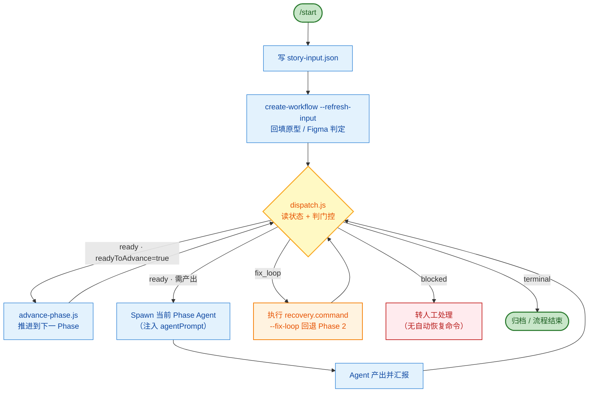

# Harness Marketplace

**端到端 AI 开发自动化工作流插件市场。**

通过安装 **Harness** 插件，为你的 AI 编程助手（Claude Code / CodeBuddy Code）接入一条覆盖「Bug 分析 → 需求分析 → 任务规划 → 代码开发 → 代码审查 → 知识库更新 → Git 提交 + MR（主流程终点）→ 云端部署（可选）」的自动化开发流水线，并配套知识库（KB）管理、文档生成、API 生成、Figma 设计稿协作等能力。

> **兼容 Claude Code 与 CodeBuddy Code**
> 两款工具使用相同的 `/plugin` 命令体系，安装步骤完全一致。
> 市场清单分别位于 `.claude-plugin/marketplace.json`（Claude Code）与 `.codebuddy-plugin/marketplace.json`（CodeBuddy Code），内容一致。
>
> **GitHub Copilot Agent Plugins 1.0** 使用独立清单 `plugins/harness-copilot/plugin.json`，不改动现有插件格式。

> **安装源（GitHub）**：`https://github.com/JayCJP/harnessflow.git`

---

## 目录

- [核心特性](#核心特性)
- [环境要求](#环境要求)
- [安装](#安装)
- [快速上手](#快速上手)
- [常用命令](#常用命令)
- [最佳实践](#最佳实践)
- [插件配置](#插件配置)
- [故障排除与卸载](#故障排除与卸载)
- [仓库结构](#仓库结构)

---

## 核心特性

### 1. 端到端 7 Phase 工作流

一条命令驱动完整研发链路，每个 Phase 有明确的 Agent 分工、产出物与门控校验：

| Phase | 阶段 | 负责 Agent | 关键产出物 |
|-------|------|-----------|-----------|
| 0 | 需求分析 | 需求分析师 | requirement-analysis.md、acceptance-criteria.json |
| 1 | 任务规划 | 任务规划师 | task-dag.md / task-dag.json（可并行任务 DAG） |
| 2 | 代码开发 | 前端开发工程师 | 代码变更（dev-pass 限时写保护） |
| 3 | 代码审查 | 代码审查师 | code-review.json（AC 逐条核对结论并入 issues[]） |
| 4 | 知识库更新 | 发布助手 | 增量知识库文档（kb-update） |
| 5 | Git 提交 + MR | 发布助手 | 提交开发分支 + 创建 MR（→ dev）+ git-submit.json 契约 |
| 6 | 云端部署（可选） | 发布助手 | dev 分支构建（env=dev, build_other=dev）+ 部署 URL |

> **主流程 = 0 → 5**：代码审查通过后先沉积知识库（不依赖已提交代码），再提交并创建 MR；
> **MR 建完即写 `status: completed`**，自动 end 与归档随之解锁。
> 云端部署（Phase 6）是可选阶段 —— 做与不做都算结束，`dispatch` 在终态下给出 `optionalNext` 提示。

#### 7 Phase 横向流转

```mermaid
flowchart LR
    subgraph SG1["需求侧"]
        P0["Phase 0<br/>需求分析<br/><i>需求分析师</i>"]
    end
    subgraph SG2["规划侧"]
        P1["Phase 1<br/>任务规划<br/><i>任务规划师</i>"]
    end
    subgraph SG3["开发侧"]
        P2["Phase 2<br/>代码开发<br/><i>前端开发工程师</i>"]
        P3["Phase 3<br/>代码审查<br/><i>代码审查师</i>"]
    end
    subgraph SG4["发布侧"]
        P4["Phase 4<br/>知识库更新<br/><i>发布助手</i>"]
        P5["Phase 5<br/>提交 + MR → dev<br/><i>发布助手</i>"]
        P6["Phase 6（可选）<br/>dev 分支构建发布<br/><i>发布助手</i>"]
    end

    P0 -->|"门控通过"| P1
    P1 -->|"门控通过<br/>签发 dev-pass"| P2
    P2 -->|"增量 lint + 编译<br/>撤销 dev-pass"| P3
    P3 -->|"无 BLOCKER"| P4
    P4 -->|"kb-update"| P5
    P5 -->|"主流程结束（completed）"| P6
    P3 -.->|"有 BLOCKER<br/>fix-loop 回退"| P2

    classDef analysis fill:#e3f2fd,stroke:#1976d2,color:#0d47a1,stroke-width:1.5px
    classDef plan fill:#f3e5f5,stroke:#7b1fa2,color:#4a148c,stroke-width:1.5px
    classDef dev fill:#e8f5e9,stroke:#388e3c,color:#1b5e20,stroke-width:1.5px
    classDef review fill:#fff3e0,stroke:#f57c00,color:#e65100,stroke-width:1.5px
    classDef release fill:#fce4ec,stroke:#c2185b,color:#880e4f,stroke-width:1.5px

    class P0 analysis
    class P1 plan
    class P2 dev
    class P3 review
    class P4,P5,P6 release

    linkStyle 6 stroke:#c62828,stroke-width:2px,stroke-dasharray:5 5
    style SG1 fill:#f8fdff,stroke:#90caf9
    style SG2 fill:#fdf4ff,stroke:#ce93d8
    style SG3 fill:#f6fdf7,stroke:#a5d6a7
    style SG4 fill:#fff5f8,stroke:#f48fb1
```



#### 主控循环（dispatch.js 四态调度）



> **核心设计：AI 不操作状态，只机械执行。**
> `dispatch.js` 是「只读调度器」——读状态、判门控、说下一步，零写权限；
> `advance-phase.js` 是「相位跃迁唯一执行者」——判门控、写状态、签发/撤销 dev-pass；
> 主 Agent 无判断权，只按 `status` 四态（ready / fix_loop / blocked / terminal）机械分支。

### 2. 契约驱动 + 硬门控

工作流不是「口头约定」，而是**结构化契约 + 程序化门控**：

- 每个 Phase 推进前，`policy.js` 校验上一 Phase 产出物是否完整、格式是否符合 schema
- 验收标准（AC）与任务（Task）交叉引用校验，杜绝「AC 全绿但功能缺失」
- Phase 2→3 自动跑**增量 ESLint + 本地编译**，编译错误不再漏到云端构建才暴露

### 3. 权限控制（dev-pass）

AI 修改 `src/` 代码受 dev-pass 通行证约束，仅在开发阶段由脚本自动签发、阶段结束自动撤销 ——
杜绝规划未定稿就动手。

文件明细不做事前拦截：Phase 1 无法穷尽依赖（新增文件 / 公共层 / 跨仓适配），开发的必要改动
不该被卡住。改在 Phase 2→3 结算 —— 脚本拿 git 实际变更比对 `task-dag.json` 的 `files[]`，
范围外改动落 `scope-amendments.json`，由 Phase 3 审查逐条核对必要性。

### 4. 知识库（KB）管理

四个 skill 按职责边界划分，覆盖知识库全生命周期：

| Skill | 调用 | 职责 | 何时用 |
|-------|------|------|--------|
| `kb-init` | `/kb-init` | 初始化骨架——自动推断项目画像与业务域，创建目录结构 + meta.yaml + 编码规范骨架 | 新项目首次初始化 |
| `gen-project-docs` | `/gen-project-docs` | 全量/单域**生成**文档——扫描源码生成 overview/architecture/api 等内容 | kb-init 后首次填充、手动重建某域、新鲜度检测 |
| `kb-query` | `/kb-query` | 分层检索——L1 overview 关键词 → L2 meta.yaml → L3 域文档 | 需求分析/改代码前自动注入历史教训 |
| `kb-update` | `/kb-update` | **增量**更新——基于 git diff 定位受影响域，AI 直接扫变更文件更新 | 任务完成后自动同步，保留手工批注 |

**布局策略**：前端项目默认带 `frontend/` 端层布局（`.docs/llm-knowledge/frontend/`，参照真实多端项目标杆，可扩展 `h5/`、`miniprogram/` 端层）；插件/后端/库为扁平布局（`.docs/llm-knowledge/`）。`kb-init.cjs` 按 `project_type` 自动决定，`gen-docs.cjs` / `kb-update.cjs` 自动探测 KB 根。

**职责边界**：生成归 `gen-project-docs`（全量/单域），增量归 `kb-update`（git diff 驱动）。`kb-update` 不调用 `gen-project-docs`，AI 直接扫 `affectedDomains.matchedFiles` 更新文档。

### 5. Figma 设计稿协作

- 提供 Figma 链接即自动开启设计稿硬门控，强制 100% 还原
- `figma-to-component-map` 产出 frame 清单与组件映射，零猜测对齐

---

## 环境要求

- 已安装 **Claude Code** 或 **CodeBuddy Code**（两者任一即可）
- 可访问 GitHub 仓库：`https://github.com/JayCJP/harnessflow.git`
- **无需 `npm install`**：插件的 JSON Schema 校验依赖（ajv）已单文件内置

### 前置 MCP 服务配置

插件市场本身**不携带**外部 MCP 服务，以下 MCP 需你在工具（Claude Code / CodeBuddy Code）中自行配置。**按需启用**——只装你实际会用到的能力对应的 MCP：

| MCP 服务 | 使用场景 | 用到它的 Agent / Skill | 必需程度 |
|---------|---------|----------------------|---------|
| **TAPD MCP** | Bug 分析、缺陷修复、需求详情拉取 | 需求分析师（fixbugs）、`tapd-bug-analyzer` | fixbugs 模式必需 |
| **Figma MCP** | 设计稿读取、frame 清单、组件映射 | 需求分析师、前端开发工程师、`figma` / `figma-to-component-map` | 有 Figma 设计稿时必需 |
| **GitLab MCP** | 创建 Merge Request | 发布助手（②创建 MR） | 需走 MR 流程时必需 |
| **DevOps MCP** | 云端构建、部署 | 发布助手（⑤构建发布） | 需云端部署时必需 |

> **提示**：以上 MCP 服务名（如 `TAPD_MCP_Server`、`Figma_MCP`、`GitLab`、`Devops`、`Sequential_Thinking`）需与工具配置中的 MCP 名称一致，Agent 通过 `mcp_call_tool(serverName, ...)` 调用。
> 未配置对应 MCP 时，涉及该能力的环节会失败并如实告知，不会静默跳过。

### 原型抓取：无需 MCP

原型抓取（墨刀 / Axure / Figma 原型）由内置 skill `prototype-capture` 通过
**`playwright-cli`**（微软官方 CLI，`@playwright/cli`）完成，**不占用 MCP 槽位**：

```bash
npm install -g @playwright/cli@latest
playwright-cli --version    # 需 ≥ 0.1.17
```

| 能力 | 使用场景 | 用到它的 Agent / Skill | 必需程度 |
|---------|---------|----------------------|---------|
| **playwright-cli**（内置 skill，无需 MCP） | 原型抓取（墨刀/Axure） | 需求分析师（原型）、`prototype-capture` | 有原型链接时必需 |

---

## 安装

安装分三步：**添加市场 → 安装插件 → 重载**。

### 第 1 步：添加市场

```bash
/plugin marketplace add https://github.com/JayCJP/harnessflow.git
```

> 已配置 GitHub SSH 密钥时，可用 SSH 方式：
> ```bash
> /plugin marketplace add git@github.com:JayCJP/harnessflow.git
> ```

添加成功后市场名为 **`harness-marketplace`**。

### 第 2 步：安装插件

```bash
/plugin install harness@harness-marketplace
```

安装时选择作用域：
- **用户作用域**（默认）：对本机所有项目生效
- **项目作用域**：仅当前仓库（写入 `.codebuddy/settings.json`，随仓库分发）
- **本地作用域**：仅本人当前仓库

### 第 3 步：重载生效

```bash
/plugin list
```

确认列表包含 `harness` 插件即安装成功。

> **AI 代理 / 详细排障请参阅 [INSTALL.md](./INSTALL.md)**，含安装前检查、冒烟测试、ajv 依赖排查等完整步骤。

---

## 快速上手

### 场景 A：新功能开发

```bash
/start STORY-001 "1v1客服等级分配模式"
```

然后在 `.codebuddy/plans/STORY-001/story-input.json` 写入原始输入：

```json
{
  "mode": "run",
  "storyId": "STORY-001",
  "title": "1v1客服等级分配模式",
  "sources": {
    "prototypeUrls": ["https://proto.example.com/xxx"],
    "figmaUrls": ["https://www.figma.com/design/AbC123/订单中心?node-id=12-345"],
    "terminal": "H5",
    "text": "补充说明"
  }
}
```

写完后回填判定（必做，否则原型/Figma 门控不生效）：

```bash
node <插件安装路径>/plugins/harness/scripts/commands/create-workflow.js STORY-001 --refresh-input
```

之后工作流由主控 Agent 自动调度，逐 Phase 推进直至部署。

### 场景 B：Bug 修复

```bash
/start <storyId> "<标题>"   # 模式由输入内容判定（缺陷 → fixbugs）
```

Bug 修复模式免原型文档要求，Phase 0 需求分析师会自动拉取 TAPD 缺陷并产出两份产物：

| 产物 | 读者 | 内容 |
|------|------|------|
| `{需求标题}_bug分析报告.md` | 人 | 问题复述、复现步骤、代码定位、根因、责任方分类 |
| `bug-list.json` | 程序 | 每个缺陷的 TAPD 状态、分诊分类、评论摘要、回写凭证 |

**Phase 0 会读每个缺陷的评论**（不论 `new` 还是 `reopened`）—— 测试常把复现环境、版本号写在评论里，
只看描述会漏掉。评论要点落进 `bug-list.json` 的 `commentDigest`，后续 Phase 直接复用，不必再翻 TAPD。

修复完成后按分类自动回写 TAPD：

| 分类 | 动作 |
|------|------|
| `frontend` 且验收通过 | 写「已修复」评论 + 状态置 `in_progress` |
| `frontend` 但修复回路用尽转人工 | 写「未自动修复」评论，**不改状态** |
| `backend` / `collab` | Phase 0 分析完即写评论转交，**不改状态**（流转权归对方） |

> 评论只写「现象 + 结论 + 需要谁做什么」，不贴代码、diff 或文件路径，总长 ≤ 120 字。

---

## 常用命令

| 命令 | 说明 |
| --- | --- |
| `/start` | 启动 / 推进工作流；新功能与 Bug 修复同一个入口，模式按输入判定 |
| `/end` | 结束当前工作流（解除 src/ 编辑限制） |
| `/evolve` | 触发插件自进化体检（audit → 度量 → 诊断 → 治疗 → 验证） |
| `/archive` | 归档已完成的迭代 / 任务 |

> 定时巡检缺陷不用命令，直接说「给这个需求建个定时修复 bug 的任务」并给出 TAPD 链接，
> 见下方[定时任务](#定时任务tapd-缺陷巡检)章节。

---

## 定时任务：TAPD 缺陷巡检

为某个 TAPD 需求创建定时任务，按 cron 周期轮询其关联缺陷。两种模式：

| 模式 | 做什么 | 副作用 |
|------|--------|--------|
| **只查** | 查询并输出缺陷清单 | 无（全程只读） |
| **自动修复** | 命中后交给 `/start` 走完整 7 Phase 流水线 | 改代码 + 写 TAPD 评论 + 改状态 |

**自动修复模式不自己实现修复** —— 分析、门控、dev-pass、验收、TAPD 回写全部由 harness 负责，
定时任务只决定「何时触发」。

### 两条运行时规则

**1. 有进行中的工作流 → 本轮直接跳过**

复用 `.codebuddy/plans/.harness-active` 作为单例锁，不另建 `.lock`：

| 情况 | 动作 |
|------|------|
| 存在且是本任务的 Story | 输出「上一轮仍在执行（Phase N），本轮跳过」 |
| 存在但是其他 Story | 输出「其他 Story 占用中，本轮跳过」 |
| 不存在 | 正常执行 |

标志残留时提示用户执行 `/end`，**定时任务不自动清理**（清理激活状态是状态操作）。

**2. reopened 判定看本地记录，不只看 TAPD**

TAPD 只说「现在是 reopened」，不说「是不是我修出来的」。判断依据在 `bug-list.json` 的
`writeback` 字段（由 `tapd-writeback.js --record` 写入）：

| 情形 | 判据 | 处置 |
|------|------|------|
| 新缺陷 | `bugs[]` 里找不到 | 正常分析 |
| 真打回 | 有 `writeback` 且最新评论时间晚于 `commentedAt` | 修完测试又复现，重新查根因 |
| 疑似误操作 | 有 `writeback` 但评论时间更早 | 状态变了没人说话，读评论确认 |
| 分类变化 | `commentKind` 是 `to_backend`/`to_collab` | 我们没修过，是别人修了被打回，需重新分类 |
| 已修复待流转 | 有 `writeback` 且 TAPD 仍是 `new` | **跳过**，等人工提测 |

### 使用

说「给这个需求建个定时修复 bug 的任务」并给出 TAPD 需求链接即可，插件会：

1. 判定模式（说不清时默认只查，并追问是否要自动修复）
2. 生成提示词（首行固定写需求中文标题，任务列表里能一眼认出）
3. 创建任务，cron 避开 0 分与 30 分，持久化 30 天，同一需求只留一个任务

> 自动修复模式会**自动改代码、写 TAPD 评论、改缺陷状态**，创建前必须确认。
> 建议先把 `.codebuddy/` 加进 `.gitignore`。

---

## 最佳实践

### 1. 工作流初始化

- **`start` 之后必须写 `story-input.json`，并执行 `--refresh-input`**。
  漏掉回填会导致两类问题：无原型的纯文字需求被卡在「必须产出 prototype-analysis.md」；有 Figma 的需求完全不会触发设计稿门控。
- **`story-input.json` 只搬运参数、不做分析**。主 Agent 原样写入用户给的链接/终端/描述，分析归 Phase 0 需求分析师，避免跨 Agent 传递丢失中间推理。

### 2. 状态文件纪律（铁律）

- 🚫 **AI 不手改 `e2e-state.json` / `dev-pass.json`**。Phase 推进、dev-pass 签发/撤销全部由脚本完成，AI 只执行 `dispatch.js` / `advance-phase.js` 给出的指令。
- 🚫 **AI 不替用户确认 `open-questions.json` 的待确认项**。建议稿只写 `resolution`；`confirmation` 字段（放行唯一依据）只经 `resolve-question.js` 在用户答复后写入，`resolved` 字段已废弃。
- 🚫 **Phase ≠ 2 时不要编辑 `src/`**，Hook 守卫会直接拒绝。
- 🚫 **不手写 `bug-list.json` 的 `writeback` 字段**。回写凭证（`commentedAt` / `commentKind`）只由
  `tapd-writeback.js --record` 写入，它是跨轮去重的唯一依据；手写等于伪造「已回写」。

### 3. Figma 使用

- 给 `sources.figmaUrls` 即**自动开启硬门控**（run 模式），强制产出 `figma-frame-inventory.json` 与 `figma-component-map.md`，task 的 `figmaNodeId` 必须命中 frame 清单。
- **前置条件：Figma 桌面端需运行并已打开文件**。未运行时子 Agent 会如实告知并停止，不会退回缓存数据 —— 这是「零猜测还原」的保障。
- `fixbugs` 模式不开硬门控（只碰个别页面，全量清单会卡死修复流程），但「有设计稿就该解析」的指引仍会注入。

### 4. run vs fixbugs 模式选择

判据只有一条：**这件事有没有新增能力？**

- **让已有的东西按原本该有的样子工作** → `fixbugs`（免原型文档、Phase 0 产出 Bug 报告与 `bug-list.json`）
- **用户能做的事变多了** → `run`（有原型/Figma 门控、featurePoints 功能点枚举）
- 信号冲突时按顺序判：**有缺陷载体（TAPD 链接）→ fixbugs；有新增载体（原型/Figma）→ run；只有自然语言 → 看动词**

**判错的代价不对称**，所以拿不准就往 `run` 靠：

| 误判方向 | 后果 |
|---------|------|
| 误判成 `run` | Phase 0 门控**显性阻塞**（要求原型分析 / featurePoints），一眼可见、一步可改 |
| 误判成 `fixbugs` | **静默**关闭 Figma 硬门控与功能点枚举，UI 没有 frame 校验、功能缺失也无人发现 |

**同一条消息里既报错又要新功能**（如「这页报错，顺便把新加的导出做了」）时不合并：
问清先后，只建一个 Story，另一件另开一轮。

### 5. storyId 与重复建流

> 🚫 **默认动作是「复用」，不是「新建」。** 重复建 Story 会让已有的分析、状态、产物全部作废。

按顺序判定，命中即停：

1. 用户消息里给了 storyId → **直接用它**
2. 给了 TAPD 需求 id → 先查是否已有 Story 覆盖同一需求（`story-input.json` 的 `sources.storyIdInTapd`）
3. `.codebuddy/plans/` 下有同主题 Story → **列给用户选**「复用还是新建」
4. 当前有激活的 Story → 脚本会提示先 `/end`，按提示处理，不要绕过
5. 确实全新 → 才新建，且**自己定 id**，不要省略让脚本自动生成

**复用已有 Story 不要调 `start`** —— `createWorkflow` 对已存在的 storyId 会报「工作流已存在」并拒绝
（这是防覆盖保护）。看到该提示的正确反应是回到三步循环接着跑，不是换个 id 重来。

### 6. 修复回路（fix-loop）

- 代码审查发现 BLOCKER（含 AC 未通过）时，工作流自动回退到 Phase 2 修复，重新签发 dev-pass。
- **默认最多 2 轮**，超出后转人工介入。不要让 AI 无限重试空转。

### 7. 知识库（KB）

- 新项目先 `/kb-init` 初始化知识库骨架（自动推断项目画像与业务域，前端项目带 `frontend/` 端层）。
- 初始化后用 `/gen-project-docs --all` 首次全量生成文档内容；后续单域改动可 `/gen-project-docs <domain_id>` 重生成。
- 需求分析/改代码前用 `/kb-query` 分层检索，历史教训会自动注入各 Phase 的 prompt。
- 任务完成后 `/kb-update` 增量同步（基于 git diff 定位受影响域，AI 直接扫变更文件更新），保留手工批注，避免每次全量重写。
- 生成归 `gen-project-docs`，增量归 `kb-update`——两者职责不重叠，触发词也不重叠。

### 8. 多项目协作

- 涉及多仓库时，需求分析师在 Phase 0 写入 story 级 `repos.json`（`primary` + `repos` 映射）。
- 跨项目 task 的 `description` 必须含行号引用，便于开发工程师定位改动点。

---

## 插件配置

安装后在 `/plugin` 界面可修改：

| 配置项 | 类型 | 说明 | 默认值 |
| --- | --- | --- | --- |
| `workspaceRoot` | string | 默认工作区根目录 | `D:/workfile` |

---

## 故障排除与卸载

### 卸载

```bash
/plugin uninstall harness@harness-marketplace
/plugin marketplace remove harness-marketplace   # 会同时卸载该市场下所有插件
```

### 常见问题

| 问题 | 解决方法 |
| --- | --- |
| 市场添加后无法加载 | 确认 GitHub 地址可访问，仓库根目录存在 `.codebuddy-plugin/marketplace.json` |
| 安装时提示「路径未找到」 | 使用 Git 型市场（`https://...git`），不要用 URL 型 |
| 命令 / 技能不显示 | `/reload-plugins` 重载，或删除缓存 `rm -rf ~/.codebuddy/plugins/cache` 后重启重装 |
| 报 `Cannot find module 'ajv'` | 确认 `plugins/harness/vendor/ajv.bundle.js` 存在，`git pull` 同步（不要 `npm install`） |
| 需要调试日志 | 启动工具时加 `--debug` 参数 |

> 更多排障细节见 [INSTALL.md](./INSTALL.md)。

---

## 仓库结构

```
harness-marketplace/
├── .codebuddy-plugin/marketplace.json   # CodeBuddy Code 市场清单
├── .claude-plugin/marketplace.json      # Claude Code 市场清单（内容一致）
└── plugins/
    ├── harness/                          # Claude Code / CodeBuddy 插件本体
    │   ├── plugin.json                   # 插件元信息（agents/skills/hooks 入口）
    │   ├── agents/                       # 5 个工程角色代理
    │   ├── skills/                       # 工作流 / 编排 / 知识库 / 文档 / 接口 / Figma 技能
    │   ├── hooks/                        # 阶段钩子（dev-pass / 状态文件守卫）
    │   ├── rules/                        # 知识库自动检索规则
    │   ├── scripts/                      # audit / services / schemas / commands
    │   ├── vendor/ajv.bundle.js          # 内置 ajv 单文件（免 npm install）
    │   └── output-styles/
    └── harness-copilot/
        └── plugin.json                   # GitHub Copilot Agent Plugins 1.0 清单
```