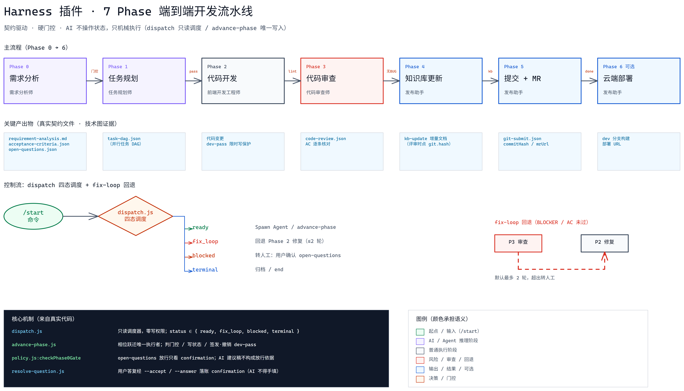

# Harness Marketplace

> **端到端 AI 开发自动化工作流插件市场。** 一条命令，让 AI 编程助手跑完「需求 → 规划 → 开发 → 审查 → 沉淀 → 提交 → 部署」的完整研发链路。

[](./plugins/harness/plugin.json)
[](#license)
[](#安装)

兼容 **Claude Code** 与 **CodeBuddy Code**（安装步骤完全一致），并提供 GitHub Copilot Agent Plugins 1.0 独立清单。

**安装源：** `https://github.com/JayCJP/harnessflow.git`

---

## 30 秒了解

| 问题 | 答案 |
|------|------|
| **这是什么？** | 一个插件市场，核心插件 `harness` 为 AI 编程助手接入一条 7 Phase 自动化开发流水线，并配套知识库、文档生成、API 生成、Figma 协作等能力。 |
| **解决什么？** | 把「分析需求 → 拆任务 → 写代码 → 审查 → 沉淀经验 → 提交建 MR → 可选部署」变成可门控、可回溯、契约驱动的自动流程，AI 只机械执行、不操作状态。 |
| **怎么用？** | 3 步安装（见[安装](#安装)），然后 `/start <storyId> "<标题>"` 启动（见[快速上手](#快速上手)）。 |

---

## 目录

- [核心特性](#核心特性)
- [环境要求](#环境要求)
- [安装](#安装)
- [快速上手](#快速上手)
- [常用命令](#常用命令)
- [关键实践](#关键实践)
- [插件配置](#插件配置)
- [故障排除](#故障排除)
- [仓库结构](#仓库结构)
- [License](#license)

---

## 核心特性

### 端到端 7 Phase 工作流

一条命令驱动完整研发链路，每个 Phase 有明确的 Agent 分工、产出物与门控校验：

| Phase | 阶段 | 负责 Agent | 关键产出物 |
|-------|------|-----------|-----------|
| 0 | 需求分析 | 需求分析师 | requirement-analysis.md、acceptance-criteria.json |
| 1 | 任务规划 | 任务规划师 | task-dag.md / task-dag.json（可并行任务 DAG） |
| 2 | 代码开发 | 前端开发工程师 | 代码变更（dev-pass 限时写保护） |
| 3 | 代码审查 | 代码审查师 | code-review.json（AC 逐条核对结论并入 issues[]） |
| 4 | 知识库更新 | 发布助手 | 增量知识库文档（kb-update） |
| 5 | Git 提交 + MR | 发布助手 | 提交开发分支 + 创建 MR（→ dev）+ git-submit.json 契约 |
| 6 | 云端部署（可选） | 发布助手 | dev 分支构建（env=dev, build_other=dev）+ 部署 URL |

> **主流程 = 0 → 5**：代码审查通过后先沉淀知识库（不依赖已提交代码），再提交并创建 MR；
> **MR 建完即写 `status: completed`**，自动 end 与归档随之解锁。
> 云端部署（Phase 6）是可选阶段 —— 做与不做都算结束，`dispatch` 在终态下给出 `optionalNext` 提示。



> 上图按「主流程 → 契约产出 → 控制流」三层展开，含真实契约文件名与 `dispatch` 四态机制。
> 可编辑源文件：[harness-flow.excalidraw](.docs/diagrams/harness-flow.excalidraw)。

> **核心设计：AI 不操作状态，只机械执行。**
> `dispatch.js` 是只读调度器（读状态、判门控、说下一步，零写权限）；`advance-phase.js` 是相位跃迁唯一执行者；主 Agent 只按 `status` 四态（ready / fix_loop / blocked / terminal）机械分支。

### 契约驱动 + 硬门控

- 每个 Phase 推进前，`policy.js` 校验上一 Phase 产出物是否完整、格式是否符合 schema
- 验收标准（AC）与任务（Task）交叉引用校验，杜绝「AC 全绿但功能缺失」
- Phase 2→3 自动跑增量 ESLint + 本地编译，编译错误不再漏到云端构建才暴露

### 权限控制（dev-pass）

AI 修改 `src/` 受 dev-pass 通行证约束，仅在开发阶段由脚本自动签发、阶段结束自动撤销 —— 杜绝规划未定稿就动手。文件明细不做事前拦截（Phase 1 无法穷尽依赖），改在 Phase 2→3 结算：git 实际变更比对 `task-dag.json` 的 `files[]`，范围外改动落 `scope-amendments.json`，由 Phase 3 逐条核对。

### 知识库（KB）管理

| Skill | 职责 | 何时用 |
|-------|------|--------|
| `kb-init` | 初始化骨架（推断项目画像与业务域） | 新项目首次初始化 |
| `gen-project-docs` | 全量/单域生成文档 | 首次填充、手动重建、新鲜度检测 |
| `kb-query` | 分层检索（overview → meta.yaml → 域文档） | 需求分析/改代码前自动注入历史教训 |
| `kb-update` | 增量更新（git diff 定位受影响域） | 任务完成后同步，保留手工批注 |

前端项目默认带 `frontend/` 端层布局，插件/后端/库为扁平布局，按 `project_type` 自动决定。

### Figma 设计稿协作

提供 Figma 链接即自动开启设计稿硬门控，强制 100% 还原；`figma-to-component-map` 产出 frame 清单与组件映射，零猜测对齐。

---

## 环境要求

- 已安装 **Claude Code** 或 **CodeBuddy Code**（任一即可）
- 可访问 `https://github.com/JayCJP/harnessflow.git`
- **无需 `npm install`**：ajv 依赖已单文件内置（`vendor/ajv.bundle.js`）

**按需配置外部 MCP 服务**（市场本身不携带）：

| MCP 服务 | 使用场景 | 必需程度 |
|---------|---------|---------|
| TAPD MCP | Bug 分析、缺陷修复、需求详情拉取 | fixbugs 模式必需 |
| Figma MCP | 设计稿读取、frame 清单、组件映射 | 有 Figma 设计稿时必需 |
| GitLab MCP | 创建 Merge Request | 需走 MR 流程时必需 |
| DevOps MCP | 云端构建、部署 | 需云端部署时必需 |

> 服务名需与工具配置中的 MCP 名称一致；未配置时相关环节会失败并如实告知，不会静默跳过。
> 原型抓取（墨刀/Axure）由内置 `prototype-capture` 通过 `playwright-cli` 完成，不占 MCP 槽位（`npm install -g @playwright/cli@latest`，需 ≥ 0.1.17）。

---

## 安装

三步：**添加市场 → 安装插件 → 重载**。

```bash
# 1. 添加市场（有 SSH 密钥时可改用 git@github.com:JayCJP/harnessflow.git）
/plugin marketplace add https://github.com/JayCJP/harnessflow.git

# 2. 安装插件（作用域：用户 / 项目 / 本地）
/plugin install harness@harness-marketplace

# 3. 重载生效
/plugin list    # 列表含 harness 即成功
```

添加成功后市场名为 **`harness-marketplace`**。AI 代理的完整安装验证与排障见 [INSTALL.md](./INSTALL.md)。

---

## 快速上手

### 新功能开发（run）

```bash
/start STORY-001 "1v1客服等级分配模式"
```

在 `.codebuddy/plans/STORY-001/story-input.json` 写原始输入：

```json
{
  "mode": "run",
  "storyId": "STORY-001",
  "title": "1v1客服等级分配模式",
  "sources": {
    "prototypeUrls": ["https://proto.example.com/xxx"],
    "figmaUrls": ["https://www.figma.com/design/AbC123/订单中心?node-id=12-345"],
    "terminal": "H5",
    "text": "补充说明"
  }
}
```

回填判定（**必做**，否则原型/Figma 门控不生效）：

```bash
node <插件安装路径>/plugins/harness/scripts/commands/create-workflow.js STORY-001 --refresh-input
```

之后由主控 Agent 自动调度，逐 Phase 推进至 Git 提交；云端部署按需触发。

### Bug 修复（fixbugs）

`/start <storyId> "<标题>"`，模式由输入内容自动判定。Phase 0 自动拉取 TAPD 缺陷并产出：

| 产物 | 读者 | 内容 |
|------|------|------|
| `{需求标题}_bug分析报告.md` | 人 | 问题复述、复现步骤、代码定位、根因、责任方分类 |
| `bug-list.json` | 程序 | 每个缺陷的 TAPD 状态、分诊分类、评论摘要、回写凭证 |

**Phase 0 会读每个缺陷的评论**（不论 new / reopened）：测试常把复现环境写在评论里，只看描述会漏掉。修复后按分类自动回写 TAPD：

| 分类 | 动作 |
|------|------|
| `frontend` 且验收通过 | 写「已修复」评论 + 状态置 `in_progress` |
| `frontend` 但修复回路用尽转人工 | 写「未自动修复」评论，**不改状态** |
| `backend` / `collab` | Phase 0 分析完即写评论转交，**不改状态** |

> 评论写协议契约（后端服务 / 接口 / 字段 / 预期值），不贴代码片段或源码路径，目标 500 字内说清楚。

---

## 常用命令

| 命令 | 说明 |
| --- | --- |
| `/start` | 启动 / 推进工作流；新功能与 Bug 修复同一入口，模式按输入判定 |
| `/end` | 结束当前工作流（解除 `src/` 编辑限制） |
| `/evolve` | 插件自进化体检（audit → 度量 → 诊断 → 治疗 → 验证） |
| `/archive` | 归档已完成的迭代 / 任务 |

**TAPD 缺陷定时巡检**：直接说「给这个需求建个定时修复 bug 的任务」并给出 TAPD 链接。两种模式：**只查**（全程只读）或**自动修复**（命中后交给 `/start` 走完整流水线）。自动修复模式不自行实现修复，分析/门控/dev-pass/验收/回写全部由 harness 负责，定时任务只决定「何时触发」。创建前必须确认（会改代码、写 TAPD 评论、改状态）。

---

## 关键实践

> 完整的使用约束与判断细则见 [INSTALL.md](./INSTALL.md) 与各 Phase 参考文档（`plugins/harness/skills/start/references/`）。

### 状态文件铁律

- 🚫 AI 不手改 `e2e-state.json` / `dev-pass.json` —— Phase 推进、通行证签发/撤销全部由脚本完成
- 🚫 AI 不替用户确认 `open-questions.json` 待确认项 —— `confirmation` 只经 `resolve-question.js` 在用户答复后写入，`resolved` 已废弃
- 🚫 Phase ≠ 2 时不编辑 `src/`（Hook 守卫直接拒绝）
- 🚫 不手写 `bug-list.json` 的 `writeback` 字段（跨轮去重唯一依据，只由 `tapd-writeback.js --record` 写入）

### 工作流初始化

- `/start` 后必须写 `story-input.json` 并执行 `--refresh-input`；漏掉会导致纯文字需求被卡「必须产出原型分析」或 Figma 门控不触发
- `story-input.json` 只搬运参数、不做分析，分析归 Phase 0

### 模式选择与建流

- **run vs fixbugs**：有新增能力 → `run`；让已有能力正常工作 → `fixbugs`。信号冲突时**宁可判 run**（误判 fixbugs 会静默关闭 Figma 硬门控与功能点枚举，代价不对称）
- **storyId 默认复用而非新建**：重复建流会让已有分析/状态/产物全部作废。给了 id 直接用；同主题 Story 列给用户选；确实全新才新建且自己定 id

### Figma / 修复回路 / KB

- 给 `sources.figmaUrls` 即开启硬门控（run 模式），前置要求 Figma 桌面端运行并打开文件；fixbugs 不开硬门控
- 审查发现 BLOCKER（含 AC 未通过）自动回退 Phase 2 修复，默认最多 2 轮，超出转人工
- 新项目先 `/kb-init`，再 `/gen-project-docs --all` 首次全量生成；完成后 `/kb-update` 增量同步（保留手工批注）。「生成」归 `gen-project-docs`，「增量」归 `kb-update`，职责不重叠

### 多项目协作

涉及多仓库时，Phase 0 写入 story 级 `repos.json`（`primary` + `repos` 映射）；跨项目 task 的 `description` 必须含行号引用。

---

## 插件配置

安装后在 `/plugin` 界面可修改：

| 配置项 | 类型 | 说明 | 默认值 |
| --- | --- | --- | --- |
| `workspaceRoot` | string | 默认工作区根目录 | `D:/workfile` |

---

## 故障排除

```bash
/plugin uninstall harness@harness-marketplace
/plugin marketplace remove harness-marketplace   # 会卸载该市场下所有插件
```

| 问题 | 解决方法 |
| --- | --- |
| 市场添加后无法加载 | 确认 GitHub 地址可访问，仓库根目录存在 `.codebuddy-plugin/marketplace.json` |
| 安装提示「路径未找到」 | 使用 Git 型市场（`https://...git`），不要用 URL 型 |
| 命令 / 技能不显示 | `/reload-plugins`，或删缓存 `rm -rf ~/.codebuddy/plugins/cache` 后重启重装 |
| 报 `Cannot find module 'ajv'` | 确认 `vendor/ajv.bundle.js` 存在，`git pull` 同步（不要 `npm install`） |
| 需要调试日志 | 启动工具时加 `--debug` |

完整排障见 [INSTALL.md](./INSTALL.md)。

---

## 仓库结构

```
harness-marketplace/
├── .codebuddy-plugin/marketplace.json   # CodeBuddy Code 市场清单
├── .claude-plugin/marketplace.json      # Claude Code 市场清单（内容一致）
├── INSTALL.md                           # AI 代理安装验证与排障
└── plugins/
    ├── harness/                          # Claude Code / CodeBuddy 插件本体
    │   ├── plugin.json                   # 插件元信息（agents/skills/hooks 入口）
    │   ├── agents/                       # 5 个工程角色代理
    │   ├── skills/                       # 工作流 / 知识库 / 文档 / 接口 / Figma 技能
    │   ├── hooks/                        # 阶段钩子（dev-pass / 状态文件守卫）
    │   ├── scripts/                      # audit / services / schemas / commands
    │   ├── vendor/ajv.bundle.js          # 内置 ajv 单文件（免 npm install）
    │   └── output-styles/
    └── harness-copilot/
        └── plugin.json                   # GitHub Copilot Agent Plugins 1.0 清单
```

---

## License

MIT © Harness Marketplace 贡献者。各插件清单（`plugin.json` / `marketplace.json`）均已声明 `"license": "MIT"`。
